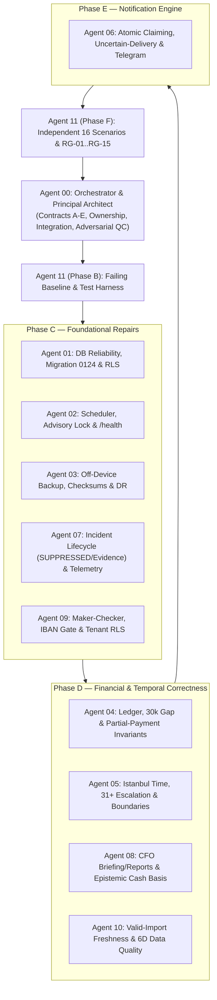

# MAS Nexus — Agent Ownership & Cross-Agent Dependency Map

## 1. Orchestration Topology (12 Agents: Agent 00 + Agents 01–11)

## 2. Strict Disjoint File Ownership Table

Each modified or created file has **exactly one designated writer**. Other agents have read-only inspection access and must consume shared types from `src/lib/contracts/remediation-contracts.ts`.

| Agent | Role | Exclusive Write Scope |Assigned Incidents |
| :--- | :--- | :--- | :--- |
| **Agent 00** | Orchestrator / Principal Architect | `src/lib/contracts/remediation-contracts.ts`, `docs/remediation/architecture-baseline.md`, `docs/remediation/incident-matrix.md`, `docs/remediation/agent-ownership.md`, `docs/remediation/integration-report.md`, `docs/remediation/final-status.md` | Global (`I-001`–`I-016`) |
| **Agent 01** | Database Reliability & Migrations | `supabase/migrations/0124_remediation_outbox_incidents_import_freshness.sql`, `docs/database-schema.md`, `tests/remediation/agent01-db-migrations.test.ts`, `docs/remediation/database-report.md` | `I-001`, `I-002`, DB parts of `I-011` |
| **Agent 02** | Infrastructure, Scheduler & Service Reliability | `scripts/ops/background-worker.ts`, `src/app/health/route.ts`, `tests/remediation/agent02-scheduler-health.test.ts` | `I-004`, infra parts of `I-001`, `I-005` |
| **Agent 03** | Backup, Restore & Disaster Recovery | `scripts/ops/backup-lib.ts`, `scripts/ops/offdevice-copy.ts`, `src/lib/ops/telemetry-alerts.ts`, `tests/remediation/agent03-backup-dr.test.ts`, `docs/remediation/backup-restore-report.md` | `I-003` |
| **Agent 04** | Financial Ledger, Reconciliation & Data Integrity | `src/lib/radar/queries.ts`, `tests/remediation/agent04-financial-reconciliation.test.ts`, `docs/remediation/financial-reconciliation-report.md` | `I-009`, `I-010`, `I-011`, `I-012` |
| **Agent 05** | Temporal Rules & Escalation Engine | `src/lib/reminders/rules.ts`, `src/lib/reminders/rules.test.ts`, `tests/remediation/agent05-temporal-escalation.test.ts` | `I-006`, `I-008` |
| **Agent 06** | Telegram Notification Engine & Idempotency | `src/lib/reminders/transport.ts`, `src/lib/reminders/engine.ts`, `tests/remediation/agent06-telegram-idempotency.test.ts`, `docs/remediation/telegram-reliability-report.md` | `I-007`, `I-014`, Telegram parts of `I-006` |
| **Agent 07** | Telemetry, Incident State & Observability | `src/lib/reminders/outbox.ts`, `src/lib/ops/alert-delivery.ts`, `scripts/ops/telemetry-snapshot.ts`, `scripts/ops/telemetry-watch.ts`, `tests/remediation/agent07-incident-lifecycle.test.ts` | `I-005`, `I-013`, telemetry parts of `I-001`–`I-004` |
| **Agent 08** | CFO Reporting & Cash-Flow Intelligence | `src/lib/reports/rules.ts`, `src/lib/reports/engine.ts`, `src/lib/reports/board-pack.ts`, `src/lib/briefing/rules.ts`, `tests/remediation/agent08-cfo-reporting.test.ts` | `I-009`, `I-010`, `I-011`, `I-008`, `I-012` |
| **Agent 09** | Security, Approval Workflows & SaaS Isolation | `src/lib/approvals/engine.ts`, `src/lib/controls/rules.ts`, `tests/remediation/agent09-security-isolation.test.ts`, `docs/remediation/security-report.md` | `I-015`, cross-cutting authz & RLS |
| **Agent 10** | Data Pipeline & Data Quality | `src/lib/data-quality/remediation-metrics.ts`, `tests/remediation/agent10-data-quality.test.ts` | `I-005`, `I-011`, `I-016` |
| **Agent 11** | Independent QA, Regression & Release Verification | `tests/remediation/mandatory-16-scenarios.test.ts`, `scripts/qa/verify-rg-15-gates.ts`, `docs/remediation/qa-release-gates.md` | Independent verification of `I-001`–`I-016` & `RG-01`–`RG-15` |
